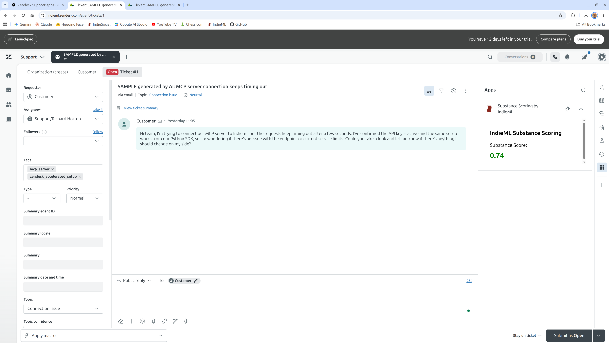

# IndieML Zendesk Integration Guide

A native Zendesk integration that evaluates ticket text for substance, depth, and clarity. Connect existing support workflows to the fast, high-volume IndieML API to instantly score, triage, and evaluate customer inquiries.

## Overview

IndieML acts as a high-speed filter directly inside the Zendesk ticket interface. When an agent opens a ticket, IndieML evaluates the ticket text and returns a normalized substance score (0.00 to 1.00) in under 30ms:

- **Low Substance (< 0.25):** Ambiguous, thin, or low-information content that likely needs clarifying detail.
- **Moderate Substance (0.25 - 0.70):** Standard conversational context.
- **High Substance (> 0.70):** Dense, actionable, detail-rich context.

---

## Prerequisite: Request API Key
Before starting, you need an API key to authenticate the connection.
Click [here](https://indieml.app/#api-key) to get your free IndieML API key. Copy the key and keep it handy for the configuration step.

---

## 60-Second Installation (Agent UI Plugin)

No servers, webhooks, or middleware required. This deploys the client-side Zendesk App Framework (ZAF) sidebar widget.

1. **Download the App Package:**
   Download [`indieml-zendesk-integration.zip`](dist/indieml-zendesk-integration.zip) from this repo.

2. **Upload to Zendesk:**
   - In Zendesk, navigate to **Admin Center** (`/admin`).
   - In the left sidebar, go to **Apps and integrations** > **Apps** > **Zendesk Support apps**.
   - Click **Upload Private App** in the upper-right corner.
   - Enter `Substance Scoring by IndieML` as the App Name and select the `indieml-zendesk-integration.zip` file.

3. **Configure Your API Key:**
   - Enter your `api_key` when prompted.
   - Click **Install**.

Open any ticket in your Support workspace; the IndieML widget will appear in the right-hand apps tray.

---

## Security & Architecture

- **Zero Middleware:** Runs entirely via the Zendesk Apps Framework (ZAF) client.
- **Secure Token Proxy:** Your API key is stored securely in Zendesk’s encrypted backend parameters (`secure: true`). The key is never exposed to browser dev tools or client-side scripts.
- **Stateless & Ephemeral:** IndieML does not store, log, or persist customer ticket data. Inputs are evaluated in-memory and discarded immediately after the score is generated.
- **Restricted Traffic:** Outbound calls are locked to `indieml.app` via `domainWhitelist`.

---

## Extending IndieML into Zendesk Pipelines

The included Zendesk App Framework (ZAF) plugin serves as a lightweight, real-time discovery tool for human agents. It allows your team to observe the substance score natively without altering existing backend rules.

However, IndieML is built as a fast, high-volume evaluation primitive designed to integrate directly into your automated support pipelines. By connecting the IndieML REST API to Zendesk Webhooks, Triggers, or middleware platforms (like Zapier or Make), operations teams can build headless triage workflows to:

- **Automated Routing:** Automatically tag or route high-substance, detail-rich technical tickets directly to specialized queues.
- **Deflection & Auto-Reply:** Intercept low-substance, zero-context inquiries (e.g., "it is broken") and automatically request reproduction steps before the ticket ever reaches a human agent's dashboard.
- **Reporting & Analytics:** Write the IndieML score to a Zendesk Custom Field via API to generate long-term reporting on customer communication trends and ticket quality.

For custom routing workflows or API documentation to build out your pipeline, visit [indieml.app](https://indieml.app).
